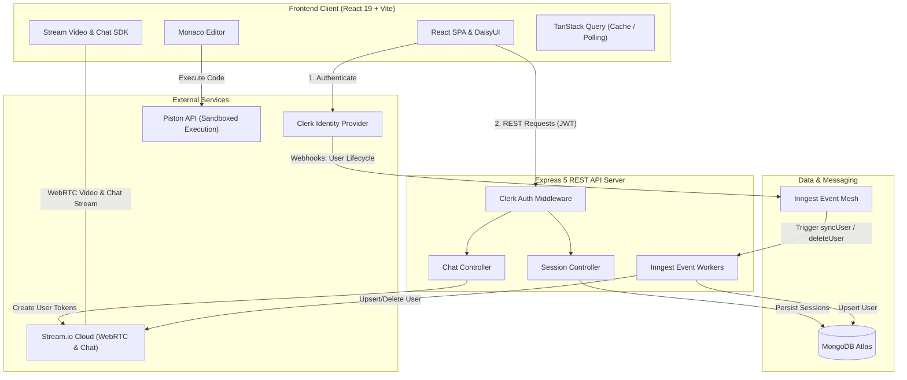
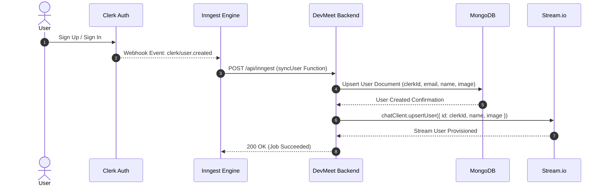
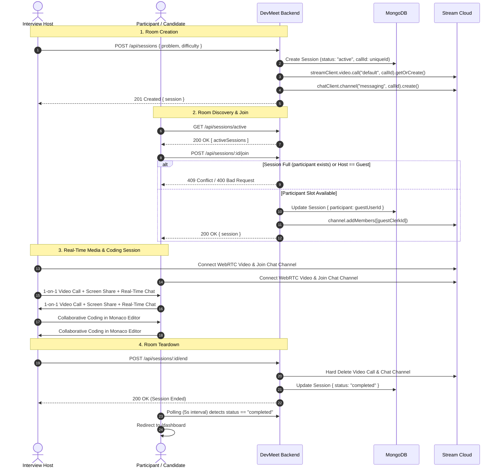
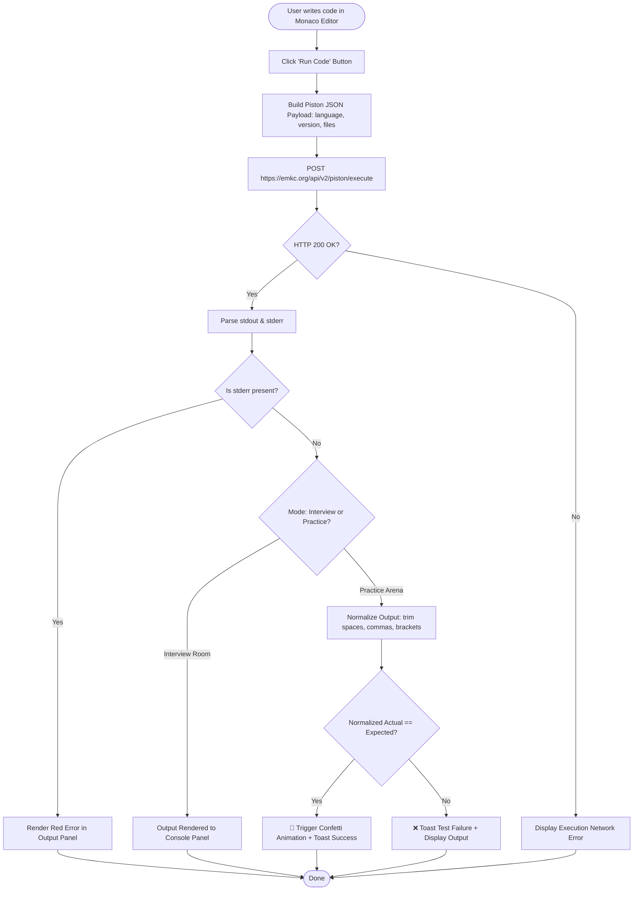

<h1 align="center">
  ⚡ DevMeet ⚡
</h1>

<h3 align="center">Next-Generation Real-Time Collaborative Technical Interview Platform & DSA Arena</h3>

<p align="center">
  A distributed, real-time technical interview platform enabling peer-to-peer 1-on-1 mock interviews with WebRTC video calling, synchronized instant messaging, interactive Monaco code editing across multiple languages, sandboxed code execution, and a solo practice arena with automated test evaluations.
</p>

<p align="center">
  <a href="https://github.com/Jais-abhi"></a>
  <a href="mailto:abhijaiswal7479@gmail.com"></a>
  
  
</p>

<p align="center">
  
  
  
  
  
  
  
  
  
  
  
</p>

---

## 📑 Table of Contents

- [Overview](#-overview)
- [Key Features](#-key-features)
- [System Architecture](#-system-architecture)
  - [High-Level Architecture](#high-level-architecture)
  - [Component Breakdown](#component-breakdown)
- [System Design & Data Flows](#-system-design--data-flows)
  - [User Synchronization Flow (Inngest + Clerk)](#1-user-synchronization-flow-inngest--clerk)
  - [Interview Session Lifecycle](#2-interview-session-lifecycle)
  - [Code Execution Pipeline (Piston API)](#3-code-execution-pipeline-piston-api)
- [Tech Stack](#-tech-stack)
- [Database Schema](#-database-schema)
- [REST API Reference](#-rest-api-reference)
- [Project Directory Structure](#-project-directory-structure)
- [Environment Variables Configuration](#-environment-variables-configuration)
- [Getting Started](#-getting-started)
  - [Prerequisites](#prerequisites)
  - [Backend Setup](#1-backend-setup)
  - [Frontend Setup](#2-frontend-setup)
  - [Monorepo Production Build](#3-monorepo-production-build)
- [Deployment](#-deployment)
- [Author & Contact](#-author--contact)

---

## 🌟 Overview

**DevMeet** is a high-performance, full-stack collaborative platform built to replicate real-world technical interviews and offer an interactive coding playground for software engineers.

Traditional interview preparation often separates video communication from coding environments. DevMeet integrates high-definition audio/video calls, real-time collaborative chat, an industrial-strength Monaco code editor (the engine powering VS Code), and sandboxed multi-language remote code execution into a single, cohesive interface.

Whether used for peer-to-peer mock interviews, recruiter-led technical rounds, or solo problem solving, DevMeet provides low-latency communication, strict room concurrency locking, automated test evaluation, and reliable asynchronous background processing.

---

## ✨ Key Features

- **🧑‍💻 VS Code-Powered Monaco Editor**
  - Syntax highlighting, code auto-completion, line numbering, custom dark theme (`vs-dark`), and language switching.
  - Native multi-language starter templates for **JavaScript (Node.js 18)**, **Python (3.10)**, and **Java (15)**.
- **🎥 1-on-1 Real-Time Video & Audio Rooms**
  - Ultra-low latency WebRTC video conferencing powered by **Stream Video SDK**.
  - Participant tile layout (`SpeakerLayout`), camera toggle, microphone muting, screen sharing, and participant counter.
- **💬 Integrated Live Room Chat**
  - Real-time persistent messaging channels powered by **Stream Chat SDK**.
  - Side-panel drawer embedded in the interview room for sharing snippets, edge cases, and links.
- **⚙️ Sandboxed Remote Code Execution**
  - Integrated with the **Piston Code Execution Engine** (`emkc.org/api/v2/piston`).
  - Executes untrusted user code safely inside isolated containers with stdout/stderr capture and runtime error reporting.
- **🔒 Strict Room Locking (1-on-1 Concurrency Guard)**
  - Dynamic session state control allowing exactly one host and one participant (`max 2 users`).
  - Guards against unauthorized intrusions; prevents hosts from joining their own rooms as participants.
- **🎯 Solo Practice Arena with Auto Test Case Evaluation**
  - Curated DSA problem sets (Arrays, Two Pointers, Strings, Sliding Window, Dynamic Programming).
  - Automated output normalization algorithm comparing actual vs. expected test case outputs.
  - Interactive feedback with **Canvas Confetti** on success and contextual toast notifications on failure.
- **🧭 Live Metrics & Analytic Dashboard**
  - Real-time count of active public rooms and personal completed interview history.
  - Instant room creation modal with problem selection and difficulty badges.
- **🧠 Reliable Event-Driven Workflows (Inngest)**
  - Webhook ingestion for Clerk authentication events (`clerk/user.created`, `clerk/user.deleted`).
  - Transactional user synchronization between MongoDB and Stream Chat user directories.
- **📐 Fluid Responsive Resizable Panels**
  - Built with `react-resizable-panels` allowing candidates and interviewers to freely customize pane widths for problem descriptions, code editor, and console output.

---

## 🏛️ System Architecture

### High-Level Architecture

The platform follows a modern decoupled micro-services / hybrid monolith architecture with a React SPA on the client side, an Express 5 REST API on the server side, MongoDB Atlas for persistent storage, and specialized external infrastructure providers (Clerk, Stream.io, Inngest, Piston).



### Component Breakdown

1. **Frontend Client (`/frontend`)**:
   - Single Page Application built using React 19, Vite, Tailwind CSS v4, and DaisyUI v5.
   - TanStack React Query handles server-state caching, optimistic mutations, and polling for live session updates.
   - Stream Video & Chat React SDKs maintain WebRTC peer connections and WebSocket chat streams.
2. **Backend API Service (`/backend`)**:
   - Express 5 REST server providing secured endpoints for room creation, user joining, lifecycle termination, and token minting.
   - Clerk Express middleware authenticates incoming Bearer tokens and matches users against the MongoDB store.
3. **Event-Driven Workflow Engine (`Inngest`)**:
   - Eliminates distributed data sync inconsistencies.
   - Asynchronously creates or deletes user records across MongoDB and Stream.io when users sign up or delete their accounts in Clerk.
4. **Sandboxed Remote Code Runner (`Piston API`)**:
   - Stateless containerized code execution service that compiles and runs code in ephemeral environments, returning runtime metrics, standard out, and standard error.

---

## 🔄 System Design & Data Flows

### 1. User Synchronization Flow (Inngest + Clerk)

Ensures zero race conditions when creating user profiles across MongoDB and Stream Chat.



---

### 2. Interview Session Lifecycle

Visualizing the end-to-end journey from room creation, concurrency guard verification, live WebRTC media negotiation, to graceful room teardown.



---

### 3. Code Execution Pipeline (Piston API)

Diagram representing the solo practice testing loop and output validation.



---

## 🛠️ Tech Stack

### Core Technologies Matrix

| Layer | Technology | Version | Purpose |
| :--- | :--- | :--- | :--- |
| **Frontend Framework** | **React** | `^19.1.1` | Declarative component UI and application state |
| **Build Tooling** | **Vite** | `^7.1.7` | Next-gen lightning-fast dev server and bundle pipeline |
| **CSS & Design System** | **Tailwind CSS** | `^4.1.14` | Modern CSS styling engine with utility classes |
| **UI Components** | **DaisyUI** | `^5.3.10` | Semantic, responsive dark-mode styled UI primitives |
| **Code Editor** | **Monaco Editor** | `^4.7.0` | Desktop-grade VS Code editor in browser |
| **Real-time Video** | **Stream Video SDK** | `^1.24.0` | WebRTC audio/video call, participant grid, screen sharing |
| **Real-time Chat** | **Stream Chat SDK** | `^13.9.0` | In-room messaging channels and typing indicators |
| **Data Fetching** | **TanStack Query** | `^5.90.5` | Asynchronous cache management, optimistic updates & polling |
| **Client Routing** | **React Router** | `^7.9.4` | Client-side routing and protected view guards |
| **Animations / FX** | **Canvas Confetti** | `^1.9.3` | Success celebration particle burst animation |
| **Toast Alerts** | **React Hot Toast** | `^2.6.0` | Non-blocking alert and status toast notifications |
| **Pane Resizing** | **React Resizable Panels**| `^3.0.6` | User-adjustable multi-pane workspace layout |
| **Backend Framework** | **Express** | `^5.1.0` | Modern REST API routing and middleware pipeline |
| **Runtime Environment**| **Node.js** | `>=18.x` | High-performance asynchronous JavaScript engine |
| **Database & ODM** | **MongoDB / Mongoose**| `^8.19.1` | NoSQL document storage and schema modeling |
| **Authentication** | **Clerk** | `^1.7.41` | End-to-end OAuth, user identity, and session tokens |
| **Background Jobs** | **Inngest** | `^3.44.3` | Event-driven background queue and webhook dispatch |
| **Code Execution** | **Piston API** | `v2` | Multi-language sandboxed remote code execution |

---

## 🗄️ Database Schema

### `User` Collection
Stores registered developers synchronized from Clerk webhooks.

```javascript
{
  _id: ObjectId,
  name: { type: String, required: true },
  email: { type: String, required: true, unique: true },
  profileImage: { type: String, default: "" },
  clerkId: { type: String, required: true, unique: true },
  createdAt: ISODate,
  updatedAt: ISODate
}
```

### `Session` Collection
Represents collaborative interview rooms, their lifecycle states, and participants.

```javascript
{
  _id: ObjectId,
  problem: { type: String, required: true },
  difficulty: { type: String, enum: ["easy", "medium", "hard"], required: true },
  host: { type: ObjectId, ref: "User", required: true },
  participant: { type: ObjectId, ref: "User", default: null },
  status: { type: String, enum: ["active", "completed"], default: "active" },
  callId: { type: String, default: "" }, // Corresponds to Stream Video Call and Chat Channel ID
  createdAt: ISODate,
  updatedAt: ISODate
}
```

---

## 🔌 REST API Reference

All protected endpoints require an authenticated Clerk session (Bearer token / session cookie managed automatically via Clerk).

### Health Check

```http
GET /health
```
- **Description**: Verifies API availability.
- **Access**: Public
- **Response**:
```json
{
  "msg": "api is up and running"
}
```

---

### Chat & Token Minting

```http
GET /api/chat/token
```
- **Description**: Generates a cryptographically signed Stream user token for WebRTC video and chat initialization.
- **Access**: Protected (Clerk Auth)
- **Response `(200 OK)`**:
```json
{
  "token": "eyJhbGciOiJIUzI1NiIsInR5cCI6IkpXVCJ9...",
  "userId": "user_2t1aBcDeFgHiJkLmNoP",
  "userName": "Abhishek Jaiswal",
  "userImage": "https://img.clerk.com/..."
}
```

---

### Interview Sessions

#### 1. Create a Session
```http
POST /api/sessions
```
- **Access**: Protected
- **Request Body**:
```json
{
  "problem": "Two Sum",
  "difficulty": "easy"
}
```
- **Response `(201 Created)`**:
```json
{
  "session": {
    "_id": "6732f91a2e9b8b001a123456",
    "problem": "Two Sum",
    "difficulty": "easy",
    "host": "6732f8a02e9b8b001a654321",
    "participant": null,
    "status": "active",
    "callId": "session_1731345678901_a8b9c",
    "createdAt": "2026-11-11T17:21:18.901Z",
    "updatedAt": "2026-11-11T17:21:18.901Z"
  }
}
```

#### 2. Get Active Sessions
```http
GET /api/sessions/active
```
- **Access**: Protected
- **Description**: Retrieves up to 20 currently active rooms with populated host and participant profile information.
- **Response `(200 OK)`**:
```json
{
  "sessions": [
    {
      "_id": "6732f91a2e9b8b001a123456",
      "problem": "Two Sum",
      "difficulty": "easy",
      "host": {
        "_id": "6732f8a02e9b8b001a654321",
        "name": "Abhishek Jaiswal",
        "email": "abhijaiswal7479@gmail.com",
        "profileImage": "https://...",
        "clerkId": "user_2t1aBc..."
      },
      "participant": null,
      "status": "active",
      "callId": "session_1731345678901_a8b9c"
    }
  ]
}
```

#### 3. Get User's Recent Completed Sessions
```http
GET /api/sessions/my-recent
```
- **Access**: Protected
- **Description**: Returns past completed interviews where the authenticated user was either the host or the participant.
- **Response `(200 OK)`**:
```json
{
  "sessions": [ ... ]
}
```

#### 4. Get Session By ID
```http
GET /api/sessions/:id
```
- **Access**: Protected
- **Response `(200 OK)`**: Full session record with populated host and participant.
- **Errors**: `404 Not Found` if the session does not exist.

#### 5. Join a Session
```http
POST /api/sessions/:id/join
```
- **Access**: Protected
- **Concurrency Guards**:
  - `400 Bad Request`: If session is already completed or if host attempts to join as participant.
  - `409 Conflict`: If session already has a participant (room is full).
- **Response `(200 OK)`**:
```json
{
  "session": { ... }
}
```

#### 6. End a Session
```http
POST /api/sessions/:id/end
```
- **Access**: Protected (Host Only)
- **Description**: Deletes the Stream video call and chat channel, sets session status to `"completed"`.
- **Response `(200 OK)`**:
```json
{
  "session": { ... },
  "message": "Session ended successfully"
}
```

---

### Inngest Webhook Endpoint

```http
ALL /api/inngest
```
- **Description**: Serves Inngest functions (`sync-user`, `delete-user-from-db`) for automated Clerk user synchronization.

---

## 📂 Project Directory Structure

```text
DevMeet/
├── backend/
│   ├── src/
│   │   ├── controllers/
│   │   │   ├── chatController.js       # Stream token minting logic
│   │   │   └── sessionController.js    # Session CRUD, joining, and teardown
│   │   ├── lib/
│   │   │   ├── db.js                   # Mongoose MongoDB connection client
│   │   │   ├── env.js                  # Centralized environment variable parser
│   │   │   ├── inngest.js              # Inngest client & background event handlers
│   │   │   └── stream.js               # Stream Video & Stream Chat SDK clients
│   │   ├── middleware/
│   │   │   └── protectRoute.js         # Clerk authentication & user lookup guard
│   │   ├── models/
│   │   │   ├── Session.js              # Session data model (active/completed)
│   │   │   └── User.js                 # User profile schema synced with Clerk
│   │   ├── routes/
│   │   │   ├── chatRoutes.js           # Routes for /api/chat
│   │   │   └── sessionRoute.js         # Routes for /api/sessions
│   │   └── server.js                   # Express application entrypoint
│   ├── .env.example                    # Backend environment template
│   └── package.json                    # Backend dependencies & dev scripts
│
├── frontend/
│   ├── public/
│   │   ├── hero.png                    # Landing page illustration
│   │   ├── java.png                    # Java language badge
│   │   ├── javascript.png              # JavaScript language badge
│   │   └── python.png                  # Python language badge
│   ├── src/
│   │   ├── api/
│   │   │   └── sessions.js             # Axios API client functions for sessions
│   │   ├── components/
│   │   │   ├── ActiveSessions.jsx      # Active room cards list on dashboard
│   │   │   ├── CodeEditorPanel.jsx     # Monaco code editor panel
│   │   │   ├── CreateSessionModal.jsx  # New session creation dialog
│   │   │   ├── Navbar.jsx              # Navigation header with user profile
│   │   │   ├── OutputPanel.jsx         # Terminal output & execution results
│   │   │   ├── ProblemDescription.jsx  # Problem statement, examples & constraints
│   │   │   ├── RecentSessions.jsx      # User interview history list
│   │   │   ├── StatsCards.jsx          # Live counter summary cards
│   │   │   ├── VideoCallUI.jsx         # Stream WebRTC video grid & live chat
│   │   │   └── WelcomeSection.jsx      # Dashboard banner & action CTA
│   │   ├── data/
│   │   │   └── problems.js             # Curated DSA problems, test cases & starter code
│   │   ├── hooks/
│   │   │   ├── useSessions.js          # TanStack Query custom hooks for session API
│   │   │   └── useStreamClient.js      # Stream video/chat client connection lifecycle
│   │   ├── lib/
│   │   │   ├── axios.js                # Configured Axios instance with credentials
│   │   │   ├── piston.js               # Piston API code execution handler
│   │   │   ├── stream.js               # Client-side Stream Video client manager
│   │   │   └── utils.js                # Difficulty badge styling & formatting helpers
│   │   ├── pages/
│   │   │   ├── DashboardPage.jsx       # Authenticated home dashboard
│   │   │   ├── HomePage.jsx            # Public landing page with features showcase
│   │   │   ├── ProblemPage.jsx         # Solo coding arena with test case validation
│   │   │   ├── ProblemsPage.jsx        # Problem library catalog
│   │   │   └── SessionPage.jsx         # 1-on-1 Live interview room
│   │   ├── App.jsx                     # Route configurations & auth guards
│   │   ├── index.css                   # Tailwind CSS v4 & DaisyUI themes import
│   │   └── main.jsx                    # React DOM root initialization with Clerk
│   ├── .env.example                    # Frontend environment template
│   ├── vite.config.js                  # Vite bundler configuration
│   └── package.json                    # Frontend dependencies & scripts
│
├── .gitignore
├── package.json                        # Root monorepo orchestration scripts
└── README.md                           # Documentation
```

---

## ⚙️ Environment Variables Configuration

Create a `.env` file in both `backend` and `frontend` directories using the reference values below.

### 1. Backend (`backend/.env`)

```ini
# Server Configuration
PORT=3000
NODE_ENV=development
CLIENT_URL=http://localhost:5173

# Database
DB_URL=mongodb+srv://<username>:<password>@cluster.mongodb.net/devmeet?retryWrites=true&w=majority

# Inngest Background Jobs
INNGEST_EVENT_KEY=your_inngest_event_key
INNGEST_SIGNING_KEY=your_inngest_signing_key

# Stream.io (Video Calling & Chat)
STREAM_API_KEY=your_stream_api_key
STREAM_API_SECRET=your_stream_api_secret

# Clerk Authentication
CLERK_PUBLISHABLE_KEY=pk_test_your_clerk_publishable_key
CLERK_SECRET_KEY=sk_test_your_clerk_secret_key
```

### 2. Frontend (`frontend/.env`)

```ini
# Clerk Authentication
VITE_CLERK_PUBLISHABLE_KEY=pk_test_your_clerk_publishable_key

# Backend API Endpoint
VITE_API_URL=http://localhost:3000/api

# Stream.io Video Key
VITE_STREAM_API_KEY=your_stream_api_key
```

---

## 🚀 Getting Started

### Prerequisites

Ensure you have the following installed and set up on your machine:
- **Node.js**: `v18.0.0` or higher
- **npm** / **yarn** / **pnpm**
- **MongoDB**: A free MongoDB Atlas cluster or local MongoDB instance
- **Clerk Account**: Free tier application for authentication ([clerk.com](https://clerk.com))
- **Stream.io Account**: Free maker account for Video & Chat ([getstream.io](https://getstream.io))
- **Inngest Account / CLI**: Local dev server or cloud project ([inngest.com](https://inngest.com))

---

### 1. Backend Setup

Open a terminal and navigate to the backend directory:

```bash
cd backend
npm install
```

Start the backend in development mode with nodemon:

```bash
npm run dev
```

The server will initialize on `http://localhost:3000`. You should see:
```text
✅ Connected to MongoDB: cluster0-shard-00-00.mongodb.net
Server is running on port: 3000
```

*(Optional)* Run the Inngest local dev server in a separate terminal:
```bash
npx inngest-cli@latest dev -u http://localhost:3000/api/inngest
```

---

### 2. Frontend Setup

Open another terminal and navigate to the frontend directory:

```bash
cd frontend
npm install
```

Start the Vite development server:

```bash
npm run dev
```

The frontend application will start on `http://localhost:5173`. Open your browser and navigate to this URL to view the app!

---

### 3. Monorepo Production Build

The root `package.json` contains unified scripts to build and run the entire application as a single deployable service:

```bash
# From the root directory:

# 1. Install dependencies for both apps and compile the frontend
npm run build

# 2. Start the production Express server (serves API & static frontend)
npm start
```

When `NODE_ENV=production`, Express automatically serves the compiled SPA files from `frontend/dist` and handles client-side route fallback.

---

## ☁️ Deployment

DevMeet is configured for rapid zero-config production deployment on platforms such as **Sevalla**, **Render**, **Railway**, or **Heroku**:

1. Link your GitHub repository (`Jais-abhi/DevMeet`) to your cloud provider.
2. Set the build command:
   ```bash
   npm run build
   ```
3. Set the start command:
   ```bash
   npm start
   ```
4. Set the environment variables in the host dashboard (`DB_URL`, `CLERK_SECRET_KEY`, `STREAM_API_KEY`, `STREAM_API_SECRET`, etc.).
5. Set `NODE_ENV=production` and `CLIENT_URL=https://your-domain.com`.

---

## 👨‍💻 Author & Contact

Developed with passion by **Abhishek Jaiswal**. Feel free to reach out for inquiries, collaboration, or feedback!

- 🐙 **GitHub**: [@Jais-abhi](https://github.com/Jais-abhi)
- ✉️ **Email**: [abhijaiswal7479@gmail.com](mailto:abhijaiswal7479@gmail.com)
- 🌐 **Project Repository**: [github.com/Jais-abhi/DevMeet](https://github.com/Jais-abhi)

---

<p align="center">
  <sub>Built with ❤️ by Abhishek Jaiswal using React, Node.js, Stream, Clerk, and MongoDB.</sub>
</p>
